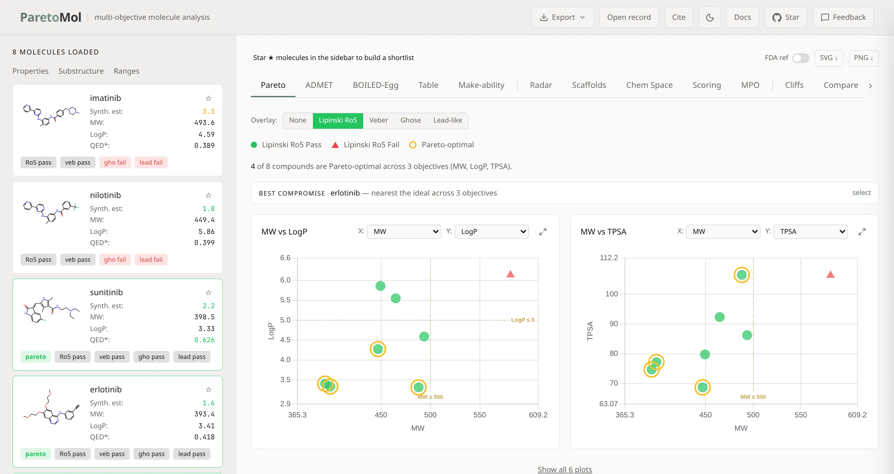
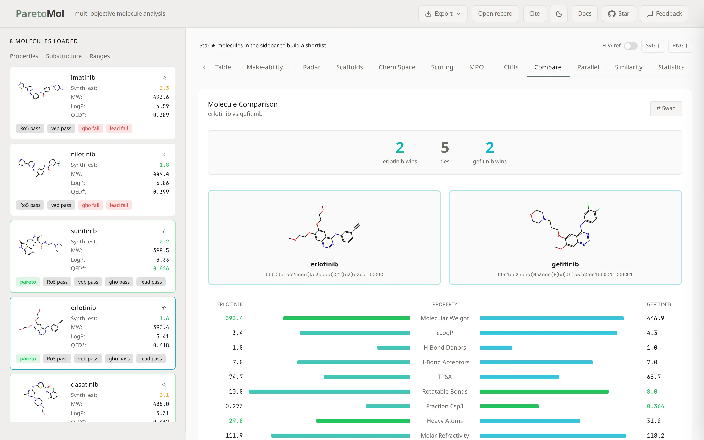
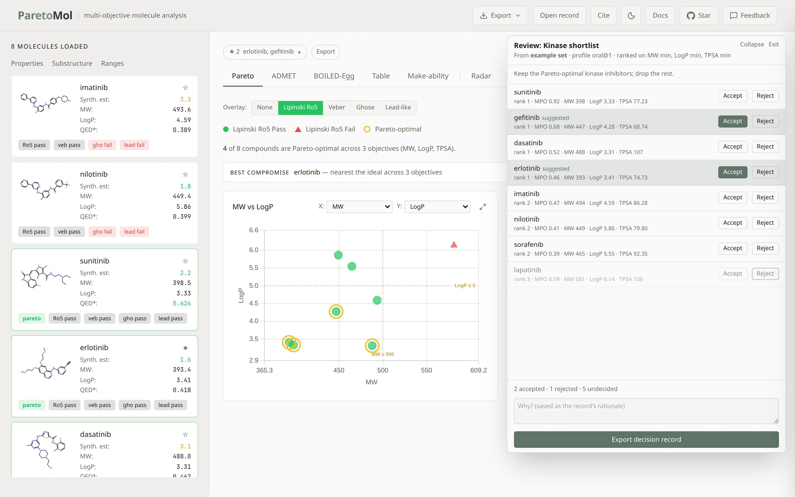

<p align="center">
  
  
</p>

<p align="center"><strong>Multi-objective Pareto analysis of drug-like molecules, computed in your browser.</strong></p>

<p align="center">
  <a href="https://paretomol.com"></a>&nbsp;&nbsp;<a href="https://doi.org/10.1039/d6dd00366d"></a>&nbsp;&nbsp;<a href="LICENSE"></a>
</p>

<p align="center">
  
</p>
<p align="center"><em>Pareto front of the built-in kinase set, ranked on MW, LogP, and TPSA.</em></p>

<p align="center">
  
</p>
<p align="center"><em>Comparison view: structures and property deltas for two molecules on the front.</em></p>

<p align="center">
  
</p>
<p align="center"><em>Review mode for a shared shortlist: accept or reject each molecule, then export the decision.</em></p>

## How to cite

If you use ParetoMol, please cite the paper:

Yabbarov, I.; Vargas-Hernández, R. A. ParetoMol: a free web application for multi-objective pareto analysis of molecular safety and pharmacokinetics. *Digital Discovery* **2026**, *5* (10), 4231-4247. [https://doi.org/10.1039/d6dd00366d](https://doi.org/10.1039/d6dd00366d)

```bibtex
@article{yabbarov2026paretomol,
  author    = {Yabbarov, Ilkham and Vargas-Hernández, Rodrigo A.},
  title     = {ParetoMol: a free web application for multi-objective pareto analysis of molecular safety and pharmacokinetics},
  journal   = {Digital Discovery},
  year      = {2026},
  volume    = {5},
  number    = {10},
  pages     = {4231--4247},
  doi       = {10.1039/d6dd00366d},
  url       = {https://doi.org/10.1039/d6dd00366d},
  publisher = {Royal Society of Chemistry}
}
```

The same citation is on the Cite control in the app ([paretomol.com](https://paretomol.com)), in `CITATION.cff`, and on every export. A ChemRxiv preprint is archived at [10.26434/chemrxiv.15002217/v1](https://doi.org/10.26434/chemrxiv.15002217/v1). Cite the Digital Discovery article.

The main analysis CSV keeps a leading `#` comment (it already did) and the citation sits on that line. Read it in pandas with `comment='#'`. Scored, shortlist, scaffold, and ADMET tables stay header-first: a comment line would be taken as the header, so the citation is a final `citation` column instead. JSON and the reproducibility manifest carry a `citation` object. SDF records carry `Citation` and `DOI` data tags. PNG and SVG figures carry the line in the margin. The Markdown report ends with the full citation.

---

Paste SMILES, upload SDF/CSV, or fetch from ChEMBL. ParetoMol computes physicochemical properties, identifies the Pareto-optimal subset across your chosen objectives, and provides 14 interactive views: Pareto fronts, BOILED-Egg, radar, MPO, scoring, chemical space, parallel coordinates, activity cliffs, scaffolds, similarity, statistics, and more. Optionally predict 41 ADMET endpoints (Chemprop D-MPNN) and fold them back into the Pareto analysis: **load, analyze, predict, re-Pareto, filter, export**.

Descriptors, Pareto ranking, filters and scoring run client-side via [RDKit.js](https://github.com/rdkit/rdkit-js) WebAssembly. No accounts.

**What leaves the browser.** Your molecules stay local except in these cases:

- **ADMET predictions** send the SMILES you predict to the Hugging Face Space [ilkhamfy/admet-ai-api](https://huggingface.co/spaces/ilkhamfy/admet-ai-api) (or to your own Space or local server if you configure one). Each visit also sends one empty health-check request to wake that Space; it carries no molecule data.
- **Name lookup**: SMILES entered without a name are sent to PubChem to fetch a common name, and names entered without SMILES are resolved through PubChem.
- **Features you invoke**: ChEMBL fetch, building-block cost (ZINC), retrosynthetic accessibility (RAscore Space), SELFIES-TED similarity, and the AI copilot (your own key, sent directly to the provider you choose) each send the relevant molecules to that service only when you use them.

Anonymous, cookie-free page and event counts via GoatCounter; no molecule data leaves the browser for analytics.

## Features

- **Pareto analysis**: non-dominated sorting over any property set; add or remove objectives, toggle min or max, instant updates
- **ADMET**: 41 endpoints via a free Hugging Face Space (no API key), one-click personal Space deploy, or self-hosted local server; PAINS / Brenk / NIH structural alerts included
- **Filtering**: SMARTS substructure search and property range sliders with mini histograms, applied across all views
- **Data in**: SMILES, SDF, CSV/TSV, clipboard paste, drag-and-drop, ChEMBL target fetch, assay-data merge by SMILES or name
- **Data out**: CSV, JSON, SDF (all or Pareto subset), per-tab PNG and SVG, Markdown report, reproducibility manifest, LZ-compressed share URL, and citation (BibTeX and RIS)
- **AI Copilot**: bring your own key (Gemini, OpenAI, Anthropic); context-aware streaming chat, keys stored in localStorage only

Tested to 2,000 molecules. ~100 KB gzipped initial bundle. Full mobile support. Press `?` in the app for keyboard shortcuts.

## Core library

The pure logic (Pareto ranking and dominance, objective directions, MPO desirability, QED, drug-likeness filters, knee point, front narrative, similarity, activity cliffs) lives in [`packages/core`](packages/core) as `@paretomol/core`: framework-free TypeScript with no DOM or network access. The web app imports it, so there is one source of truth, and scripts, notebooks or agents get the same numbers as the app.

It also ships versioned scoring profiles (`oral@1`, `cns@1`, `leadlike@1`, `lipinski@1`, and a `custom@1` template) as JSON, each with a SHA-256 content hash:

```ts
import { getProfile, mpoScore, computeParetoAndDominance } from '@paretomol/core';
const oral = getProfile('oral@1');   // oral.hash === 'sha256:…'
mpoScore({ MW: 320, LogP: 2.1, HBD: 1, HBA: 5, TPSA: 70, RotBonds: 4 }, oral.desirability);
```

Build it with `npm run build -w @paretomol/core`.

## Development

```bash
git clone https://github.com/IlkhamFY/paretomol.git
cd paretomol && npm install && npm run dev
```

TypeScript strict mode. `npm run build` must pass before committing.
